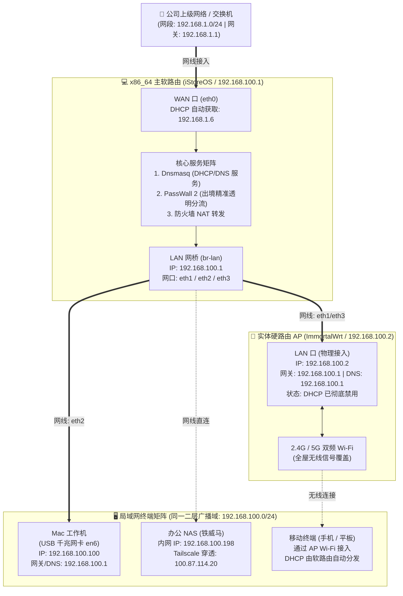
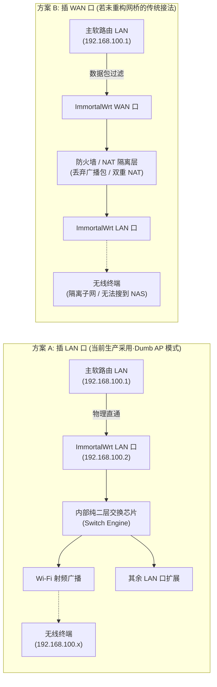

# 公司双路由联动与 ImmortalWrt AP 模式实战手册

> 📌 **版本**：V1.0 生产环境沉淀档案  
> 📅 **沉淀日期**：2026-11-03  
> 🏢 **应用场景**：公司办公室网络改造（x86_64 软路由 + ImmortalWrt 实体硬路由 AP）  
> ⚠️ **核心原则**：软路由统揽全局（拨号/分流/DHCP/DNS），硬路由仅做纯无线 AP（零 NAT、零防火墙阻隔、全网二层直通）。

---

## 一、 整体网络拓扑与设备分工



### 核心角色权责表
| 设备名称 | 硬件形态 | 承担角色 | 核心工作与状态 |
| :--- | :--- | :--- | :--- |
| **主软路由** | x86_64 迷你主机 | **全网大脑 (主路由)** | 运行 iStoreOS。负责 WAN 口 DHCP 联网、PassWall 2 出境透明分流（AI 双轨出口隔离）、局域网唯一 DHCP 服务器、唯一 DNS 解析网关。 |
| **硬路由** | Newifi 3 / MT7621 | **纯 Wi-Fi 节点 (Dumb AP)** | 运行 ImmortalWrt。**彻底关闭 DHCP、关闭 NAT、绕过防火墙**，仅提供 2.4G/5G 无线射频接入与二层交换机扩展。 |
| **Mac 工作机** | macOS M 系列 | **AI 业务开发主机** | 通过 USB 千兆网卡 (`en6`) 直连软路由，配置静态 IP `192.168.100.100`，网关与 DNS 均锁定 `192.168.100.1`。 |
| **铁威马 NAS** | 私有云存储设备 | **团队办公数据中心** | 接入软路由内网，依赖 Tailscale P2P 打洞穿透，软路由已放行 `3478,41641` UDP 握手端口。 |

---

## 二、 全网 IP 资产与接口规划表

| 节点 / 接口 | 所属设备 | 物理接口代号 | IPv4 配置类型 | IP 地址 / 掩码 | 网关 | DNS 服务器 | 备注 |
| :--- | :--- | :--- | :--- | :--- | :--- | :--- | :--- |
| **上级公司网络** | 公司交换机 | - | - | `192.168.1.1/24` | - | 运营商 DNS | 公司局域网主网段 |
| **软路由 WAN** | 主软路由 | `eth0` | DHCP 客户端 | `192.168.1.6/24` | `192.168.1.1` | `192.168.1.1` | 已剥离家庭 PPPoE 账号 |
| **软路由 LAN** | 主软路由 | `br-lan` (`eth1~3`) | 静态 IP | `192.168.100.1/24` | - | `127.0.0.1` | 局域网主网关，内网 DHCP 源 |
| **硬路由 LAN** | ImmortalWrt AP | `br-lan` (LAN 口) | 静态 IP | `192.168.100.2/24` | `192.168.100.1` | `192.168.100.1` | **AP 管理后台**，DHCP 已关闭 |
| **Mac 本机** | Mac 电脑 | `en6` (USB 网卡) | 手动静态 | `192.168.100.100/24` | `192.168.100.1` | `192.168.100.1` | 生产主力机，直通软路由 |
| **办公 NAS** | 铁威马 NAS | 物理网口 1 | DHCP 动态获取 | `192.168.100.198/24` | `192.168.100.1` | `192.168.100.1` | **已在线 (0.89ms)**，SMB/Web 正常 |

---

## 三、 今日打通与配置实录（4 步闭环）

### 步骤 1：软路由 WAN 口由家庭 PPPoE 切换为公司 DHCP
* **问题背景**：软路由从家庭环境带到公司，原备份配置中 `network.wan` 固化了电信 PPPoE 拨号账号（`18952028814`），插在公司交换机上不断拨号超时，无法上网。
* **修改动作**：
  ```bash
  uci set network.wan.proto='dhcp'
  uci delete network.wan.username
  uci delete network.wan.password
  uci delete network.wan.norelease
  uci commit network
  /etc/init.d/network restart
  ```
* **验证结果**：WAN 口立即从公司交换机获取到 `192.168.1.6`，软路由底层 `ping 223.5.5.5`（11.4ms）与访问百度 HTTP 200 正常。

### 步骤 2：PassWall 2 规则继承与分流服务激活
* **问题背景**：WAN 网络通畅后，出境分流需确保双轨隔离生效。
* **分流架构**：
  * 主分流节点：`Xray` 分流主控。
  * `AI_APAC`（低延迟出口）：分配给 Antigravity、Gemini API、GitHub，端口 `127.0.0.1:2006`。
  * `AI_US`（高风控出口）：锁定固定美国原生 IP，分配给 Claude Code、Codex、Grok (xAI)，端口 `127.0.0.1:2005`。
    * **2026-11-12 关键加固**：追加 `domain:arkoselabs.com`、`domain:challenges.cloudflare.com`、`domain:accounts.google.com`，实现人机验证、5秒盾与 OAuth 登录和 AI 主站 100% 锁死在同国出口。
  * `Default`（通用出口）：日常网页与 YouTube，端口 `127.0.0.1:2004`。
* **验证结果**：重启 PassWall 2 后，三大子节点全部以独立 `sing-box` 进程在后台稳定监听。

### 步骤 3：Mac 本机网卡 DNS 遗漏故障修复
* **问题背景**：用户反馈软路由通网后，Mac 依然打不开网页。
* **排查根因**：Mac 网卡「USB 10/100/1000 LAN」(`en6`) 虽然手动填了 IP `192.168.100.100` 和网关 `192.168.100.1`，但 **DNS 服务器一栏完全留空**，导致系统能连通 IP 但无法解析任何域名。
* **修复动作**：
  * **命令行修复**：`networksetup -setdnsservers "USB 10/100/1000 LAN" 192.168.100.1`
  * **图形界面路径**：系统设置 ➡️ 网络 ➡️ USB 10/100/1000 LAN ➡️ 详细信息 ➡️ DNS 标签 ➡️ 点击「+」填入 `192.168.100.1`。
* **验证结果**：Mac 终端与浏览器访问百度（国内直连）与谷歌（境外分流）瞬间秒开。

### 步骤 4：ImmortalWrt 硬路由改造成纯无线 AP
* **修改路径**：进入 ImmortalWrt 界面（`网络` ➡️ `接口` ➡️ 编辑 `lan`）。
* **具体配置项**：
  1. **IPv4 地址**：由 `192.168.1.1` 改为 `192.168.100.2`。
  2. **IPv4 网关**：填入 `192.168.100.1`。
  3. **IPv4 广播地址**：彻底清空留白。
  4. **DNS 服务器**：在「高级设置」中填入 `192.168.100.1`。
  5. **禁用 DHCP**：在「DHCP 服务器」的常规设置中，勾选 **「忽略此接口」**；在 IPv6 设置中将路由通告服务和 DHCPv6 设为 **「已禁用」**。
* **物理接线**：主软路由 LAN 口（eth1/eth3）网线 ➡️ ImmortalWrt 的 **LAN 口**。

---

## 四、 核心原理剖析：接 LAN 口 vs 接 WAN 口的区别

很多传统家庭网络习惯插二级路由的 WAN 口，但在打造专业企业/开发者工作流时，**为什么 OpenWrt/ImmortalWrt 做 AP 必须插 LAN 口？**



### 深度对比矩阵
| 维度 | 接 LAN 口（当前方案 · 纯交换机 AP） | 接 WAN 口（普通模式 / 未做桥接） |
| :--- | :--- | :--- |
| **网络层级** | **纯二层交换网络 (Layer 2)** | 三层路由转发 (Layer 3) |
| **NAT 转换** | **0 次 NAT**（直通主路由，零性能开销，无二次延迟） | **双重 NAT**（增加握手延迟，打洞穿透严重受阻） |
| **广播域与多播** | **全网统一广播域**：mDNS、SSDP、Bonjour 协议畅行无阻 | **防火墙隔离**：WAN 口防火墙默认丢弃内网广播包 |
| **设备无缝互访** | 手机连 Wi-Fi 与电脑插网线**完全同级**，秒搜 NAS 与打印机 | 手机访问电脑或 NAS 经常“找不到设备”，AirDrop 偶发失效 |
| **为什么传统路由能插 WAN** | 小米/TP-Link 开启 AP 模式时，固件后台自动把 WAN 物理口合并进了 LAN 网桥 | OpenWrt/ImmortalWrt 默认没有合并，插 WAN 口会被防火墙拦截 |
| **若想在 ImmortalWrt 插 WAN 口** | 必须在后台删除 WAN 接口，并在 `br-lan` 设备中将物理 WAN 口打勾勾选进网桥 | - |

---

## 五、 日常运维与应急排查手册

### 1. 两台设备后台访问地址
* **主软路由后台**（管科学分流、全网 IP 分配、外网监控）：  
  👉 **`http://192.168.100.1`**（账号: `root` / 密码: `password`）
* **硬路由 AP 后台**（管 Wi-Fi 名称、信道优化、Wi-Fi 密码）：  
  👉 **`http://192.168.100.2`**（账号: `root` / 密码: `password`）

### 2. 常见问题排查（1 分钟急救）
1. **手机连上 Wi-Fi 无法获取 IP 或显示“无互联网连接”**：
   * 检查主软路由与硬路由之间的网线是否插在两端的 **LAN 口**。
   * 确认 ImmortalWrt 后台的 DHCP 服务是否彻底勾选了「忽略此接口」（严禁两个路由同时发 IP）。
2. **打不开 `192.168.100.2` 管理界面**：
   * 确保电脑或手机的当前 IP 是 `192.168.100.x`。
   * 检查 ImmortalWrt 的网关和 DNS 是否正确指向了 `192.168.100.1`。
3. **NAS 接入内网后搜索不到**：
   * 若 NAS 原本写死了静态 IP `192.168.1.198`，需将 NAS 重启并设置为 DHCP，或临时将电脑网卡增加一个 `192.168.1.100` 辅助 IP 登录 NAS 管理页修改。
